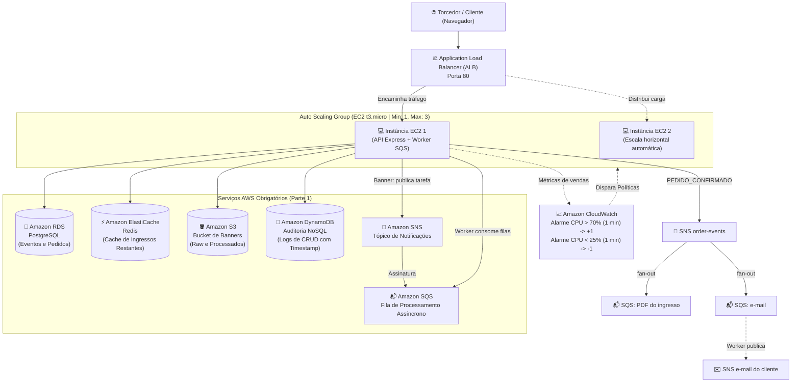

# Loja de Ingressos para Jogos de Futebol - AWS Cloud

Trabalho Prático 1 da disciplina **Desenvolvimento de Software para Nuvem (UFC)**  
**Professores:** Dr. Paulo A. L. Rego e Dr. Fernando Antonio Mota Trinta  

---

## 🎯 Visão Geral

Plataforma de alta disponibilidade e elasticidade na nuvem AWS para venda de ingressos de jogos de futebol, implementando controle atômico de concorrência, camada de cache distribuído em memória, processamento assíncrono de banners e auditoria completa em banco NoSQL.

### Funcionalidades

- **Setores com preço próprio** (Arquibancada Norte e Sul, Cadeira Central, Camarote) escolhidos num **mapa clicável do estádio**.
- **Reserva temporária de 10 minutos** no checkout: os ingressos saem do estoque ao reservar e voltam sozinhos se a compra não for confirmada (cronômetro na tela).
- **Ingresso em PDF com QR code assinado**, gerado em segundo plano e guardado de forma privada no S3 (download por link temporário).
- **E-mail de confirmação** com o link do ingresso, enviado via **Amazon SNS** (o SES é bloqueado no AWS Academy).
- **Meus ingressos**: cada torcedor vê só as próprias compras e baixa os PDFs.
- **Painel admin** (acesso apenas pelo endereço `/admin.html`): CRUD de jogos e setores, pedidos, auditoria e monitor de instâncias.
- **Elasticidade demonstrável**: teste de carga com **k6** (relatório com gráficos) e **dashboard do CloudWatch** com CPU, instâncias, requisições, filas e vendas.

---

## 🏛️ Arquitetura na Nuvem AWS

A infraestrutura foi desenhada e provisionada em conformidade com as **duas partes** solicitadas na especificação do trabalho:



---

## 📋 Conformidade com os Requisitos do Trabalho

| Requisito do Trabalho | Serviço AWS Utilizado | Como foi implementado |
| :--- | :--- | :--- |
| **1. Execução na EC2** | Amazon EC2 | Aplicação Node.js rodando em instâncias EC2 (`t3.micro`) configuradas via `systemd` e `user_data`. |
| **2. Banco Relacional** | Amazon RDS (PostgreSQL) | Fonte única de verdade para eventos, pedidos **e usuários** (compartilhados por todas as instâncias do ASG). Compra com `UPDATE ... WHERE available >= n` transacional: nunca vende mais que o estoque. Se o RDS falhar a API retorna erro (sem fallback para arquivo local). |
| **3. Arquivo Binário** | Amazon S3 | Armazenamento dos banners (`banners/raw/`) e thumbnails (`banners/processed/`). Só aceita imagens (JPEG/PNG/WEBP/GIF); leitura pública via bucket policy (sem ACL). O Terraform cria o bucket. |
| **4. Cache em Memória** | Amazon ElastiCache (Redis) | Cache acelerador de alta frequência para a listagem de jogos e estoque disponível (`events:list`), invalidado a cada nova compra. |
| **5. Auditoria NoSQL** | Amazon DynamoDB | Registro de todas as operações de CRUD (`CREATE`, `READ`, `UPDATE`, `DELETE`, `ORDER`, `RESCALE_BANNER_*`) com tipo de ação, dados manipulados e timestamp. Um índice (`by-time`) lista os registros mais recentes em ordem. |
| **6. Desacoplamento Assíncrono** | Amazon SNS / SQS | (a) **Banner**: a API grava a imagem no S3, publica no SNS (entregue ao SQS) e responde na hora; o **Worker** redimensiona com `sharp`. (b) **Compra**: a API publica um único evento `PEDIDO_CONFIRMADO` no SNS, que faz **fan-out** para duas filas SQS independentes — uma gera o **PDF com QR code** (S3 privado) e a outra envia o **e-mail** ao cliente (SNS e-mail). Cada fila tem **DLQ**. |
| **Parte 2: Elasticidade Horizontal** | ALB + Auto Scaling Group + CloudWatch | Balanceador de carga à frente de 1 a 3 instâncias com regras de escalabilidade por CPU (>70% escala +1, <25% escala -1 por mais de 1 minuto). **Dashboard do CloudWatch** com CPU, instâncias, requisições, filas e métricas de vendas; carga gerada com **k6** (`loadtest/`). |

---

## 📂 Estrutura do Repositório

```text
├── backend/
│   ├── server.js            # Ponto de entrada: sobe o Express (src/app.js) e inicializa RDS/Redis
│   ├── worker.js            # Worker desacoplado: consome a fila, redimensiona imagens (sharp)
│   ├── schema.sql           # Esquema relacional (RDS PostgreSQL) - fonte única
│   ├── test-api.test.js     # Testes automatizados da API e do Worker (Node test runner)
│   ├── package.json         # Dependências (Express, pg, redis, sharp, AWS SDK v3)
│   └── src/                 # Arquitetura MVC, um módulo (pasta) por CRUD
│       ├── app.js           # Monta o Express: middlewares + rotas de cada módulo
│       ├── bootstrap.js     # Inicialização (schema do RDS, Redis)
│       ├── config/          # Variáveis de ambiente e caminhos
│       ├── lib/             # Infra compartilhada: db (RDS), cache (Redis), storage (S3), queue (SNS/SQS), localStore (dev)
│       ├── middlewares/     # auth (JWT/admin), upload (multer), errorHandler
│       └── modules/
│           ├── events/      # CRUD de jogos: model, controller, routes, validation
│           ├── orders/      # Compra (estoque atômico), listagem (admin) e "meus ingressos": model, controller, routes
│           ├── users/       # Cadastro e login de clientes: model, controller, routes, password
│           ├── auth/        # Login do administrador
│           ├── audit/       # Auditoria no DynamoDB: model, controller, routes
│           └── system/      # /health (ALB) e /stress (teste de elasticidade)
├── frontend/
│   ├── index.html           # Vitrine, login e checkout
│   ├── meus-ingressos.html / .js # Tela "Meus ingressos": pedidos do usuário logado
│   ├── admin.html / admin.js # Painel admin: CRUD, pedidos, auditoria, monitor AWS e teste de carga
│   ├── app.js               # Integração assíncrona da vitrine/checkout
│   └── styles.css           # Estilização moderna e responsiva
├── infra/
│   ├── main.tf              # Provisionamento completo em Terraform (ALB, ASG, RDS, Cache, S3, DynamoDB, SNS/SQS + DLQ)
│   ├── variables.tf         # Declaração de variáveis
│   ├── outputs.tf           # Saídas da infraestrutura (URL do ALB, endpoints dos bancos)
│   ├── user_data.sh.tpl     # Script de bootstrap automatizado para a EC2
│   ├── terraform.tfvars.example # Exemplo de configuração
│   └── README.md            # Documentação da infraestrutura e roteiro de gravação do vídeo
├── loadtest/
│   ├── k6-elasticidade.js   # Teste de carga da Parte 2 (k6), com relatório HTML
│   └── README.md            # Como rodar o k6 e o que mostrar no vídeo
├── docker-compose.yml       # Ambiente local com PostgreSQL e Redis para testes
└── README.md                # Este documento
```

### Padrão MVC por módulo

Cada recurso fica em sua pasta em `backend/src/modules/<recurso>/` com:

| Camada | Arquivo | Responsabilidade |
| :--- | :--- | :--- |
| **Model** | `*.model.js` | Acesso a dados (RDS ou store local em dev). Sem conhecer HTTP. |
| **Controller** | `*.controller.js` | Valida a entrada e orquestra model + S3 + cache + auditoria + fila; monta a resposta. |
| **Routes** | `*.routes.js` | Liga URL/verbo HTTP aos controllers e aplica os middlewares (admin, usuário, upload). |
| **View** | `frontend/` | Interface web que consome a API JSON. |

Para criar um novo CRUD, crie a pasta do módulo e registre suas rotas em `src/app.js`.

---

## 💻 Como Executar Localmente

### 1. Iniciar Banco e Cache Locais (Opcional)
Sem `DATABASE_URL` a API usa um arquivo local (`backend/data/store.json`) — **apenas para desenvolvimento**.
Para testar com PostgreSQL e Redis locais via Docker:
```bash
docker compose up -d
cd backend && cp .env.example .env   # já aponta para os containers
export $(grep -v '^#' .env | xargs)  # ou: node --env-file=.env server.js
```

### 2. Rodar a API e o Worker
```bash
cd backend
npm install

# Em um terminal, inicie a API:
npm start

# Em outro terminal, inicie o Worker desacoplado de fila:
npm run worker
```

Acesse a interface no navegador em: `http://localhost:3000`

### 3. Rodar os Testes Automatizados
```bash
cd backend
npm test
```
*Executa 18 testes: rotas da API, healthcheck, autenticação, validações, upload só de imagens, compras concorrentes por setor (nunca vende acima do estoque), setores, reserva temporária (confirmação, cancelamento, expiração e limpeza pelo worker), PDF + e-mail via fan-out, "Meus ingressos" (cada usuário só vê os próprios), log de auditoria e processamento desacoplado do Worker. Os testes usam pastas temporárias e podem ser repetidos à vontade. Funcionam em modo local e também com `DATABASE_URL`/`REDIS_URL` apontando para Postgres/Redis reais.*

---

## ☁️ Como Fazer o Deploy na AWS (Terraform)

Para subir a infraestrutura completa na nuvem e obter a URL do Application Load Balancer:

```bash
cd infra
cp terraform.tfvars.example terraform.tfvars   # preencha db_password, admin_password e repo_url
terraform init
terraform plan
terraform apply -auto-approve
```

O Terraform imprimirá a URL pública da aplicação:
```bash
application_url = "http://stadium-tickets-alb-XXXXX.us-east-1.elb.amazonaws.com"
```

---

## 🎥 Demonstração da Parte 2 (Vídeo do Auto Scaling)

A especificação do trabalho exige um vídeo demonstrando o Auto Scaling respondendo à carga:
1. Abra o **dashboard do CloudWatch** (`terraform output cloudwatch_dashboard_url`) e o painel `http://<URL-do-ALB>/admin.html` → Infraestrutura → **Monitorar**.
2. Rode o teste de carga com o **k6** (ver [loadtest/README.md](loadtest/README.md)): ele chama a rota `/stress` (restrita ao admin) e gera um relatório HTML com gráficos.
3. No console da AWS, acompanhe:
   - A CPU média subindo acima de 70% por 1 minuto.
   - O alarme do **CloudWatch** disparando a política de Scale-Out.
   - O **Auto Scaling Group** criando uma nova instância EC2 e registrando-a no Target Group do ALB.
   - Após o término do teste, a CPU caindo abaixo de 25% e o Auto Scaling encerrando a instância excedente.
